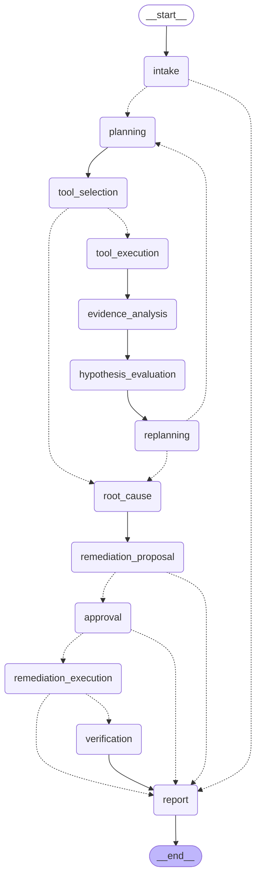

# Investigation engine (LangGraph)

Phase 4 deliverable. Code: [backend/src/ai_sre/agent/](../backend/src/ai_sre/agent/).

The investigator is a **controlled, stateful workflow**: explicit LangGraph nodes and conditional
edges, typed state, checkpoints in PostgreSQL, hard limits, and a human-in-the-loop interrupt
before any remediation. It is not a free-running chatbot. It gathers evidence only through the
[MCP tools](mcp.md) of the [simulated environment](simulator.md).

## 1. Run it

```bash
uv run poe sim-up                           # the environment
docker compose up -d postgres               # checkpoint store (platform database)
AI_SRE_MCP_REMEDIATION_ENABLED=true uv run poe mcp     # tool servers (remediation optional)
uv run simctl trigger orders-n-plus-one-deploy --speed 20

uv run python -m ai_sre.agent investigate \
  "Investigate why our orders API has been returning 500 errors and experiencing high latency for the last 20 minutes."
#   → report, or "AWAITING HUMAN APPROVAL" with the proposed action
uv run python -m ai_sre.agent approve <investigation-id> --approver <your-name>     # or --reject
uv run python -m ai_sre.agent show <investigation-id>
uv run python -m ai_sre.agent cancel <investigation-id>
uv run python -m ai_sre.agent graph         # Mermaid diagram of the workflow
```

Options: `--reasoner rules|llm` (default `rules`; `llm` uses the configured provider, Gemini, and
falls back to rules on any LLM error), `--memory` (no persistence), `--max-rounds`,
`--max-tool-calls`, `--verify-wait`.

`approve` is the human's action: it uses the MCP **admin** token (from your environment) to mint a
single-use approval token, then resumes the checkpointed graph. The agent itself never holds that
token.

## 2. Workflow



Solid edges are unconditional, dotted edges conditional.

| # | Node | Does | Deterministic? |
|---|------|------|----------------|
| 1 | `intake` | Parses the question: affected services, time window, severity, symptoms, missing information, assumptions. Reads the tool registry (are the servers reachable? is remediation enabled?) | rules or LLM (validated) |
| 2 | `planning` | Round 1: broad triage (anomalies, deployments, error signatures, dependencies, service status, pools, golden signals, incident history). Later rounds: discriminating calls for the leading hypotheses | rules or LLM (allow-listed) |
| 3 | `tool_selection` | De-duplicates against calls already made, orders by priority, cuts to the remaining tool budget | yes |
| 4 | `tool_execution` | Runs the selected calls through the tool gateway (MCP, ≤ 4 in parallel), each becoming an `Evidence` record (`ev-001`…) | yes |
| 5 | `evidence_analysis` | Normalises evidence into typed findings (deployment, metric anomaly with onset, error signature, pool saturation, slow query, idle-in-transaction, dependency health, memory growth, similar incident…) and builds the timeline | yes |
| 6 | `hypothesis_evaluation` | Generates candidate root causes (each deployment/config change, Redis, payments provider, DB network, slow queries, worker, memory, traffic) and evaluates supporting/contradicting findings, temporal relation to the onset, mechanism, topology and history; scores them | yes |
| 7 | `replanning` | Decides: stop (sufficient evidence, limits, cancelled, tools unavailable, plan exhausted, error) or another round | yes |
| 8 | `root_cause` | Picks the top hypothesis, applies the "competing explanations" cap, explains it with cited evidence, lists alternatives with why they rank lower, snapshots the component's metrics for later verification | yes |
| 9 | `remediation_proposal` | Ordered steps from a catalog (risk, expected impact, reversible?); requests an approval for the first executable step (MCP returns `approval_required`) | yes |
| 10 | `approval` | **`interrupt()`**: the run pauses and is checkpointed. Resumed with human decisions | human |
| 11 | `remediation_execution` | Calls the MCP remediation tool with the approval token. Records `executed` only if the server confirms; otherwise `failed` | yes |
| 12 | `verification` | Waits, re-reads the component's golden signals, compares with the snapshot: `resolved` / `improved` / `no_change` / `worse` | yes |
| 13 | `report` | Final report (structured + Markdown) | yes |

### Stop conditions

| Stop reason | When |
|-------------|------|
| `sufficient_evidence` | top hypothesis ≥ 0.75 confidence **and** ≥ 0.10 ahead of the runner-up |
| `max_rounds` | `Limits.max_rounds` (default 3) investigation rounds done |
| `tool_budget` | `Limits.max_tool_calls` (default 24) used; remaining planned calls are skipped and listed as limitations |
| `time_budget` | wall clock over `Limits.time_budget_s` (default 300 s) |
| `plan_exhausted` | a round produced no new calls |
| `tools_unavailable` | the registry is unreachable, or every call failed |
| `cancelled` | `python -m ai_sre.agent cancel <id>` set `cancel_requested` |
| `error` | a node failed after retries; the report is built from the evidence so far |

Loops are bounded by code: rounds, calls and time are checked in `replanning` and
`tool_selection`. The reasoner cannot extend them, and the tests prove that an always-asking
reasoner still stops.

### Reliability

- **Typed state**: `InvestigationState` (`TypedDict`) of Pydantic models ([models.py](../backend/src/ai_sre/agent/models.py)); lists written by several nodes use reducers.
- **Checkpointing + persistence**: `AsyncPostgresSaver` (platform DB) after every step; the
  serializer explicitly allows only the agent's models. An approval-paused run resumes from another
  process.
- **Retries**: the gateway retries transient tool failures (timeouts, backend outages, transport
  errors) once with backoff; every node retries transient exceptions once more.
- **Timeouts**: per tool (MCP), per backend request, per node (60 s default, 150 s tool execution).
- **Error recovery**: a failing node records a `NodeError` and a limitation and routes to the
  report. Failed tool calls become limitations and lower confidence (coverage gaps).

### Approval: never bypassed

1. Remediation tools live on a separate MCP server, token and allow-list. Investigation nodes can
   only call read-only tools (the gateway raises otherwise).
2. The agent can only *request* an approval; the MCP server stores the request.
3. Only a human with the admin token can approve. The token is single-use, expires, and is bound to
   the exact action and parameters.
4. The graph additionally refuses decisions without a token or with a non-human approver
   (`agent`, `ai-sre`, `mcp`), and treats missing decisions as rejections.
5. Remediation must be enabled in configuration, or nothing is even requested.

### Knowledge (Phase 5)

Triage includes `knowledge.find_similar_incidents`; the root-cause node retrieves runbooks and
procedures (`knowledge.search_knowledge`) and compares the evidence with the matching past incident
(`knowledge.compare_with_incident`). Only *confident* matches count as historical matches. The
report's **References** section is built only from these retrieved results (source file, section,
incident id, evidence id), and superseded runbooks are listed as not used. See
[knowledge.md](knowledge.md).

## 3. Confidence

Computed in code ([hypotheses.py](../backend/src/ai_sre/agent/hypotheses.py)), rubric v1 from
[agent-design.md § 6](agent-design.md):

```
0.15 prior + corroboration (1/2/≥3 evidence domains: 0.10/0.20/0.30)
     + temporal (strong 0.20, plausible 0.10, violation −0.40)
     + topology (on the causal path 0.05, else −0.10)
     + mechanism (strong 0.15, moderate 0.08)
     + historical match 0.05
     − 0.15 per contradicting finding (max −0.30)
     − 0.05 per failed tool call (max −0.15)
bands: high ≥ 0.75 · medium ≥ 0.50 · low ≥ 0.30 · insufficient
cap:   runner-up within 0.10 → at most medium ("competing explanations")
```

*Temporal* first uses a **before/after check**: for every deployment hypothesis the planner calls
`compare_metric_windows(split_at=<deploy time>)` on the service's key signals (error rate and p99
for HTTP services; failure rate and queue depth for the worker). A clear rise right after the
deploy makes the relation `strong`; flat or falling signals count as contradicting evidence.
Without that check, it compares the change with the onset of the **current** anomaly episode (the metrics tool
reports the start of the latest contiguous anomalous run, so an earlier resolved episode does not
mislead it). Errors that only relay a downstream failure (`UpstreamError`, "returned HTTP 5xx")
count **against** a deployment of the relaying service. That is how the gateway red herring in
scenario A is rejected.

## 4. Reasoners

| Reasoner | Intake | Planning | Used when |
|----------|--------|----------|-----------|
| `rules` | regex/keyword parsing | fixed triage + hypothesis-specific discriminators | default; no API key needed; tests |
| `llm` | structured output (`_LLMScope`), unknown services dropped | structured output (`_LLMPlan`), tools outside the read-only allow-list dropped | `--reasoner llm` with a configured LLM key |

Evidence, findings, hypotheses, confidence, stop decisions and approvals never depend on the LLM.

## 5. Example (scenario A, captured 2026-11-23)

```text
=== inv-20261123-115211-88b7: AWAITING HUMAN APPROVAL ===
Root cause: d-408 (orders-service 2.3.1 -> 2.4.0) caused the incident (high, 0.78)
  [p1] Roll back orders-service, undoing d-408. risk=medium reversible=True approval_request=apr-9fdbcddd2502
```

After approval the graph executes the rollback, waits, verifies and writes the full report (summary,
severity, affected services, root cause with cited evidence and confidence breakdown, alternative
hypotheses including the red-herring `d-407`, timeline, evidence table, recommendations, actions
taken, verification before/after table, limitations).

## 6. Tests

| Command | What | Time |
|---------|------|------|
| `uv run poe test-py` (`backend/tests/agent/test_graph.py`) | Deterministic graph tests with a fake gateway: intake parsing, triage plan, root cause + interrupt, targeted replanning, resume → execute → verify → report, rejection, refusal of approvals without token/human, failed action never reported as success, remediation disabled, tool errors as limitations, tools unavailable, tool budget, **loop prevention** (endless reasoner stops at `max_rounds`), cancellation, node crash recovery, confidence rubric and monotonicity, sufficiency margin, report citations, LLM reasoner validation and fallback | ~10 s |
| `uv run poe test-agent-e2e` (`test_agent_e2e.py`, needs `sim-up` + Postgres) | Real graph + real MCP over HTTP against live scenarios: **A** investigate → interrupt → human approval via the admin endpoint → resume from Postgres checkpoints in a fresh investigator → rollback executed → verification `resolved`/`improved` → report; **B** Redis, **D** payments provider, **C** worker deploy: correct root cause category/component | ~6 min |
