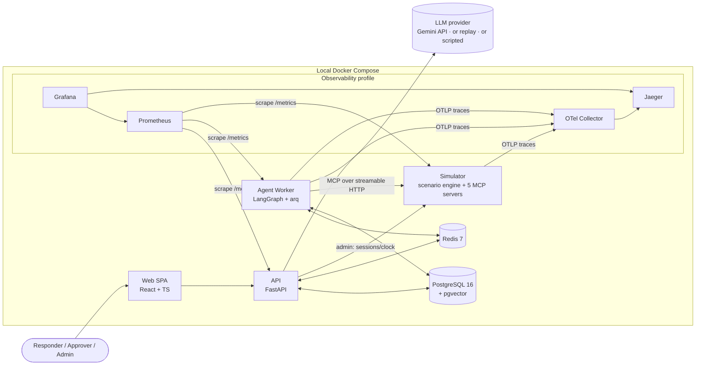

# AI SRE — System Architecture

> Status: **Approved** (2026-11-23; decisions recorded inline) · Owner: project lead · Last updated: 2026-11-23
>
> Companion documents:
> [agent-design.md](agent-design.md) · [security-design.md](security-design.md) ·
> [evaluation-plan.md](evaluation-plan.md) · [implementation-roadmap.md](implementation-roadmap.md)

---

## 1. Purpose and scope

AI SRE is an autonomous **incident investigator**. A responder asks a question in natural
language ("Why has API latency increased and why are orders failing in the last 15 minutes?").
The system then:

1. turns the question into a scoped investigation (services, symptoms, time window),
2. writes an explicit investigation plan,
3. collects evidence through tools (logs, metrics, deployments, infrastructure, database,
   historical incidents, runbooks),
4. correlates the evidence into ranked root-cause hypotheses,
5. assigns a **computed** confidence and lists its limitations,
6. produces an evidence-cited report with a timeline and recommendations, and
7. can propose remediation actions. These run only after explicit human approval, and in the
   MVP they run only against a simulator.

Everything runs locally with Docker Compose and synthetic telemetry. The only optional
external dependency is the LLM API, and an offline mode exists for that too (§ 9).

### 1.1 Design principles

| # | Principle | Consequence |
|---|-----------|-------------|
| P1 | **Evidence is created by the system and cited by the LLM.** | Tool results become `Evidence` records with IDs. The LLM can only refer to existing IDs, and a deterministic validator rejects anything else. |
| P2 | **Deterministic where possible, LLM where necessary.** | Time arithmetic, correlation features, confidence scoring, citation checks and remediation policy are plain code. The LLM handles language, planning and judgement. |
| P3 | **The LLM never holds a dangerous capability.** | The remediation *execute* tool is never bound to any LLM call. A deterministic node calls it, and only with a signed, single-use approval token. |
| P4 | **Bounded everything.** | Every investigation has hard caps on iterations, tool calls, tokens, wall-clock time and tool output size. |
| P5 | **Reproducible by construction.** | The simulator is seed-deterministic with a virtual clock. LLM calls can be recorded and replayed, so CI never needs an API key. |
| P6 | **Measure before tuning.** | The evaluation harness arrives in Phase 4, before any prompt or scoring tuning. |
| P7 | **Boring infrastructure.** | One Python backend package, one simulator package, Postgres for everything durable, and Redis for queues and live events. No Kubernetes, Kafka or separate vector DB. |

---

## 2. Requirements analysis

### 2.1 Mapping requirements to components

| # | Requirement | Where it lives | MVP depth |
|---|-------------|----------------|-----------|
| 1 | NL incident investigation | `intake` node, API `POST /investigations` | Full |
| 2 | Stateful LangGraph workflows | `agent/graph.py`, Postgres checkpointer | Full |
| 3 | Tool calling + MCP | Tool Gateway + 5 MCP servers in the simulator | Full |
| 4 | Structured investigation plans | `planner` node, `InvestigationPlan` schema | Full |
| 5 | Logs/metrics/deploy/infra/DB investigation | MCP servers: telemetry, changes, infrastructure, database | Full (traces deferred) |
| 6 | Historical incident RAG | `knowledge` module, pgvector + FTS hybrid | Full |
| 7 | Evidence correlation + RCA | `correlate` (deterministic) + `analyze` (LLM) | Full |
| 8 | Confidence + limitations | `score_confidence` (deterministic rubric) | Full; learned calibration is future work |
| 9 | Investigation timeline | Incident timeline + agent activity timeline | Full |
| 10 | Human approval before risky actions | `approval_gate` (LangGraph `interrupt`) + signed tokens | Full |
| 11 | Safe remediation simulation | Remediation MCP server mutates **simulator state only** | Full |
| 12 | Persistent investigation state | Postgres domain tables + LangGraph checkpoints | Full |
| 13 | Observability of AI execution | OpenTelemetry traces, Prometheus metrics, Grafana dashboards | Full |
| 14 | Evaluation framework | `evals/` package, scenario suites, ground truth | Full |
| 15 | Frontend dashboard | React SPA | Core screens |
| 16 | AuthN + AuthZ | Local users, JWT, RBAC (4 roles) | Full; OIDC is future work |
| 17 | Dockerized local deployment | `docker-compose.yml` with profiles | Full |
| 18 | CI/CD | GitHub Actions: CI, eval, release to GHCR | Full |
| 19 | Documentation | `docs/` + README + ADRs | Full |

### 2.2 Ambiguities and the assumptions I made

These need your confirmation. Each assumption has a default that the design uses until you
decide otherwise.

| # | Ambiguity | Assumption / default | Why it matters |
|---|-----------|----------------------|----------------|
| A1 | **"No paid cloud services" vs. needing an LLM.** A hosted LLM API is a paid service. | **Decided (2026-11-23):** development uses the **Gemini API free tier** (`gemini` provider). `replay` (recorded responses) keeps CI free and deterministic. `scripted` serves unit tests. A paid provider (e.g. `anthropic`) and `ollama` can be added behind the same interface later. | Free-tier quotas are small (requests per day per model), which limits how many eval repeats can run per day. See evaluation-plan § 4.2. |
| A2 | **Which model, and whether to mix tiers.** | Default `gemini-3.5-flash-lite` (stable, the most generous free quota). The model is configurable (`AI_SRE_GEMINI_MODEL`), per node later, so a stronger model (e.g. Gemini Flash) can be used where the eval harness shows it is needed. | Cost/quota per investigation versus quality. |
| A3 | **What "the last 15 minutes" is relative to** in a simulated world. | Each simulator session has a **virtual clock**. An investigation captures `reference_time` from that clock at creation. All windows are resolved deterministically against it. | Without this, evals are not reproducible. |
| A4 | **"Investigation timeline"**: the incident's timeline or the agent's? | **Both**: (a) the *incident timeline* (what happened in the system, built from evidence timestamps) and (b) the *investigation activity log* (what the agent did and when). | UI and schema. |
| A5 | **"Optionally execute approved remediation"**: real or simulated? | MVP is **simulated only**. Remediation acts on simulator state, and the next telemetry query shows the effect. Real executors are future work behind the same contract. | Safety and scope. |
| A6 | **Is Prometheus/Grafana the *data source* the agent investigates, or the monitor for the AI SRE itself?** | MVP: Prometheus/Grafana/OTel observe **the AI SRE platform**. The agent investigates **simulator data** via MCP. Adapters for real Prometheus/Loki come later behind the same tool contracts. | Real Prometheus cannot easily serve deterministic, back-dated, seeded scenarios. Using it as the data source would wreck reproducibility. |
| A7 | **Distributed traces** as an evidence source. | Deferred to post-MVP (a `traces.*` tool family). | Saves 1–2 weeks. Logs + metrics + deploys cover the MVP scenarios. |
| A8 | **Multi-tenancy.** | Single organisation, single environment namespace. | Schema and auth simplicity. |
| A9 | **Trigger model.** | MVP: investigations are started manually by a human. Alert-triggered investigations are future work. | Avoids an alert-routing subsystem. |
| A10 | **Who can approve.** | **Decided (2026-11-23):** RBAC role `approver`. Self-approval is **allowed** (including high risk; `ALLOW_SELF_APPROVAL_HIGH=true`). A second seeded approver user is still created so the four-eyes flow can be demonstrated and the flag flipped later. | Solo-developer convenience; four-eyes remains one setting away. |
| A11 | **Clarifying questions.** Should the agent ask the user when the query is vague? | MVP: no conversational clarification. `intake` records **explicit assumptions** in the report instead. Interactive clarification is future work. | Keeps the graph linear and the run non-blocking. |
| A12 | **Follow-up questions** after a report ("what about the payments service?"). | MVP: a follow-up starts a new investigation linked to its parent (`parent_id`) that reuses the evidence. True conversational continuation is future work. | Keeps the state model simple. |

---

## 3. System context



---

## 4. Component responsibilities

### 4.1 Web SPA (`frontend/`)

- React 18 + TypeScript + Vite, TanStack Query (server state), React Router, Tailwind,
  Recharts (small inline charts).
- API types are generated from FastAPI's OpenAPI schema (`openapi-typescript`), so frontend
  and backend contracts cannot silently drift.
- Live investigation progress uses Server-Sent Events, consumed with a fetch-based SSE client
  (`@microsoft/fetch-event-source`). Native `EventSource` cannot send the `Authorization` header.
- Renders all LLM- and telemetry-derived text as **plain text or sanitised Markdown with raw
  HTML disabled**. Log lines are attacker-controllable (see security-design § 4).

### 4.2 API service (`backend/src/ai_sre/api`)

- FastAPI, Pydantic v2, SQLAlchemy 2 (async) + asyncpg, Alembic migrations.
- Handles authentication, RBAC checks, CRUD over investigations and knowledge, approval
  decisions, SSE fan-out and the audit log.
- **Never runs the agent graph.** It enqueues jobs, so a slow LLM cannot take down request
  handling.
- On approval it **resumes** the paused graph by enqueuing a `resume_investigation` job with
  the decision payload.

### 4.3 Agent worker (`backend/src/ai_sre/worker`, `.../agent`)

- Same Python package as the API, different entrypoint (`python -m ai_sre.worker`). One
  codebase and one image keep things simple for a solo developer.
- Consumes jobs from Redis via **arq** (asyncio-native, small). Jobs: `run_investigation`,
  `resume_investigation`, `reindex_knowledge`.
- Builds the LangGraph graph with the **AsyncPostgresSaver** checkpointer. A worker crash
  mid-investigation can be resumed from the last checkpoint (see agent-design § 9).
- Owns the **Tool Gateway** (§ 4.5) and the **LLM access layer** (§ 9).
- Publishes progress events (Redis Stream per investigation + durable rows in Postgres).

### 4.4 Simulator (`simulator/`)

A separate Python service that plays the part of "production". It is the most important
enabler for the project: without a believable, deterministic world, the agent cannot be built
or evaluated.

- **Scenario engine.** Scenarios are YAML files: services and topology, baseline metric
  profiles, deployments and config changes, fault injections with ramp and effects,
  distractors (red herrings), and adversarial content (prompt-injection strings, fake
  secrets).
- **Lazy, seeded generation.** Telemetry is *computed on query* as a pure function of
  `(scenario, seed, session_state, time range)`. Nothing is pre-generated or stored, so
  queries are fast and fully reproducible.
- **Sessions.** Every investigation (and every eval run) gets its own `sim_session_id` with an
  isolated virtual clock and mutable state. Remediation changes only that session's state.
  Concurrent evals cannot interfere.
- **Five MCP servers**, mounted in one process at separate paths (`/mcp/telemetry`,
  `/mcp/changes`, `/mcp/infrastructure`, `/mcp/database`, `/mcp/remediation`). They are
  logically separate servers with distinct trust levels but one container, which avoids five
  containers' worth of operational overhead.
- **Admin HTTP API** (`/sim/*`): create/destroy sessions, read/advance the virtual clock, list
  scenarios. Only the backend can reach it.
- **Ground truth is not here.** Expected answers live in `evals/ground_truth/`, a different
  package the simulator never loads. Fault definitions themselves are never exposed through
  any tool; tools return only *derived telemetry*.

### 4.5 Tool Gateway (`backend/src/ai_sre/tools`)

Every tool call, from any node, goes through one choke point:

```
LLM tool call ─► schema validation ─► authorization (node allow-list)
  ─► budget check ─► context injection (sim_session_id, reference_time)
  ─► cache lookup (Redis, per investigation) ─► MCP / in-process call (timeout, retry)
  ─► size cap + summarisation ─► secret redaction ─► Evidence creation
  ─► persistence (tool_calls, evidence) ─► OTel span + metrics ─► event publish
  ─► compact, ID-tagged result back to the LLM
```

- **Two transports.** An MCP client (official `mcp` Python SDK, streamable HTTP) for simulator
  servers, and in-process callables for knowledge tools (they need the backend DB and the
  embedding model).
- **LLM-facing schemas are curated.** The gateway publishes tool schemas *minus* injected
  fields (`session_id`, `reference_time`). The LLM cannot choose which environment it queries.
- I recommend a thin custom wrapper over the `mcp` SDK instead of `langchain-mcp-adapters`.
  We need per-call injection, redaction, evidence creation and budgets, and those are easier
  to own than to hook into an adapter.

### 4.6 Knowledge service (`backend/src/ai_sre/knowledge`)

- Corpus: Markdown postmortems (`knowledge/incidents/*.md`) and runbooks
  (`knowledge/runbooks/*.md`) with YAML front-matter.
- Ingestion CLI: parse → chunk by heading (~400–600 tokens) → embed → upsert by content hash
  (idempotent).
- Embeddings: **local**, `fastembed` with `BAAI/bge-small-en-v1.5` (384-dim, ONNX, CPU, no
  PyTorch). The model is baked into the image, so nothing is downloaded at runtime.
- Retrieval: **hybrid**. pgvector cosine (HNSW) + Postgres full-text search, fused with
  Reciprocal Rank Fusion, filtered by service/category metadata. Hybrid matters here because
  incident text is full of exact identifiers (error codes, service names) that pure vector
  search handles poorly.

### 4.7 Data stores

| Store | Holds | Notes |
|-------|-------|-------|
| PostgreSQL 16 + pgvector | Users, investigations, plans, tool calls, evidence, hypotheses, timeline, reports, actions, approvals, audit log, knowledge chunks + embeddings, eval runs, **LangGraph checkpoints** | Single source of truth. Image: `pgvector/pgvector:pg16`. |
| Redis 7 | arq job queue, per-investigation event streams (live tail, TTL 24h), tool-result cache, rate limits, approval-token replay set (`jti`) | Nothing in Redis is the only copy of anything important. |

### 4.8 Observability stack (compose profile `observability`)

OTel Collector → Jaeger (traces); Prometheus scrapes `/metrics` on api, worker and simulator;
Grafana with provisioned datasources and dashboards. Details in § 8.

---

## 5. Key runtime flows

### 5.1 Investigation lifecycle

```mermaid
sequenceDiagram
  autonumber
  participant U as User (SPA)
  participant A as API
  participant R as Redis
  participant W as Worker (LangGraph)
  participant S as Simulator (MCP)
  participant L as LLM
  participant P as Postgres

  U->>A: POST /investigations {query, scenario}
  A->>S: create sim session (scenario, seed)
  A->>P: insert investigation (queued, reference_time)
  A->>R: enqueue run_investigation
  A-->>U: 202 {id}
  U->>A: GET /investigations/{id}/events (SSE)
  W->>R: dequeue
  loop graph nodes
    W->>L: structured / tool-calling request
    W->>S: MCP tool calls (via Tool Gateway)
    W->>P: persist evidence, steps, checkpoint
    W->>R: XADD event
    A-->>U: SSE event
  end
  W->>P: report + proposals; status=awaiting_approval
  U->>A: POST /actions/{id}/approve
  A->>P: approval + audit
  A->>R: enqueue resume_investigation {decision, token}
  W->>S: remediation.execute (token verified server-side)
  W->>S: re-query metrics (verification)
  W->>P: status=completed
```

### 5.2 Investigation status model

```
queued → running → awaiting_approval → executing_action → completed
            │             │                                  ▲
            │             └── (all rejected / closed) ───────┘
            ├──► completed           (no actions proposed)
            ├──► failed              (unrecoverable error; partial report kept)
            ├──► timed_out           (wall-clock budget exceeded; partial report kept)
            └──► cancelled           (user cancel)
```

A report exists as soon as `synthesize_report` finishes, even while the investigation is
`awaiting_approval`.

---

## 6. Data model (PostgreSQL)

All IDs are UUIDv7 (time-ordered) unless noted. `jsonb` holds validated Pydantic payloads.
LangGraph checkpoint tables (`checkpoints`, `checkpoint_writes`, `checkpoint_blobs`, …) are
managed by `langgraph-checkpoint-postgres` and are **never** queried by the UI. They exist to
resume execution, not to serve reads.

### 6.1 Identity and audit

```sql
users (
  id uuid pk, username text unique not null, email text unique,
  password_hash text not null,              -- argon2id
  role text not null check (role in ('viewer','responder','approver','admin')),
  is_active bool not null default true,
  created_at timestamptz not null default now()
)

refresh_tokens (
  id uuid pk, user_id uuid fk → users, token_hash text not null,
  expires_at timestamptz not null, revoked_at timestamptz,
  replaced_by uuid,                         -- rotation chain; reuse ⇒ revoke family
  created_at timestamptz not null default now()
)

audit_log (                                  -- append-only (trigger blocks UPDATE/DELETE)
  id bigserial pk, occurred_at timestamptz not null default now(),
  actor_type text check (actor_type in ('user','agent','system')),
  actor_id text, action text not null,       -- e.g. 'action.approved', 'investigation.created'
  resource_type text, resource_id text,
  details jsonb not null default '{}',
  prev_hash text, row_hash text              -- hash chain (tamper evidence)
)
```

### 6.2 Investigations

```sql
investigations (
  id uuid pk, parent_id uuid null fk → investigations,
  created_by uuid fk → users,
  query text not null,
  status text not null,                      -- see § 5.2
  scenario_id text, sim_session_id text,     -- simulator binding
  reference_time timestamptz not null,       -- virtual "now"
  scope jsonb,                               -- IncidentScope (services, window, symptoms, assumptions)
  graph_thread_id text unique not null,      -- LangGraph thread
  llm_provider text, llm_model text, prompt_version text,
  budget jsonb,                              -- limits + consumption
  tokens_in int default 0, tokens_out int default 0, cost_usd numeric(10,4) default 0,
  error jsonb,
  created_at timestamptz, started_at timestamptz, finished_at timestamptz
)
index (status, created_at desc); index (created_by, created_at desc)

plan_steps (
  id uuid pk, investigation_id uuid fk, iteration smallint not null,
  ordinal smallint not null, domain text not null,   -- logs|metrics|changes|infra|database|knowledge
  objective text not null, hypothesis_keys text[] default '{}',
  status text not null,                      -- pending|running|done|failed|skipped
  findings jsonb,                            -- structured StepFindings
  started_at timestamptz, finished_at timestamptz
)

tool_calls (
  id uuid pk, investigation_id uuid fk, plan_step_id uuid null fk,
  node text not null, tool_name text not null, server text not null,
  args jsonb not null,                       -- redacted, post-injection
  status text not null,                      -- ok|error|timeout|denied|cached|budget_exceeded
  latency_ms int, result_bytes int, truncated bool default false,
  result_summary text, result jsonb,         -- redacted, size-capped
  error text, trace_id text, span_id text,
  created_at timestamptz not null
)

evidence (
  id uuid pk, short_id text not null,        -- 'ev_12' — what the LLM cites; unique per investigation
  investigation_id uuid fk, tool_call_id uuid fk,
  kind text not null,                        -- metric_anomaly|log_signature|deployment|config_change|
                                             -- db_health|infra_state|alert|historical_incident|runbook
  service text, signal text,                 -- e.g. 'http_p99_latency_ms'
  observed_start timestamptz, observed_end timestamptz, onset_at timestamptz,
  summary text not null,                     -- one-line, human readable
  attributes jsonb not null default '{}',    -- numbers: baseline, peak, ratio, counts, version…
  created_at timestamptz,
  unique (investigation_id, short_id)
)

hypotheses (
  id uuid pk, investigation_id uuid fk, key text not null,     -- 'h1'
  title text not null, category text not null,                 -- RootCauseCategory enum
  component text,                                              -- service/resource
  trigger_ref text,                                            -- e.g. deployment id
  mechanism text,                                              -- causal narrative
  status text not null,                                        -- open|supported|refuted|inconclusive
  confidence_score real, confidence_band text,                 -- high|medium|low|insufficient
  score_breakdown jsonb,                                       -- feature contributions
  rank smallint, iteration smallint,
  unique (investigation_id, key)
)

hypothesis_evidence (
  hypothesis_id uuid fk, evidence_id uuid fk,
  relation text check (relation in ('supports','contradicts','context')),
  primary key (hypothesis_id, evidence_id)
)

timeline_events (
  id uuid pk, investigation_id uuid fk,
  lane text check (lane in ('incident','investigation')),      -- A4
  occurred_at timestamptz not null,
  kind text not null, title text not null,
  evidence_id uuid null fk, tool_call_id uuid null fk,
  significance text                                            -- trigger|symptom|context|action
)

reports (
  investigation_id uuid pk fk, version int not null default 1,
  summary text not null,                     -- 2–4 sentence answer to the user's question
  report jsonb not null,                     -- RootCauseReport (validated)
  limitations jsonb not null,                -- list of {kind, text}
  validation jsonb not null,                 -- citation/entity check results
  created_at timestamptz
)

investigation_events (                       -- durable event log for SSE replay
  id bigserial pk, investigation_id uuid fk, seq int not null,
  type text not null, payload jsonb not null, created_at timestamptz,
  unique (investigation_id, seq)
)

feedback (
  id uuid pk, investigation_id uuid fk, user_id uuid fk,
  rating smallint check (rating between -1 and 1),
  correct_category text, correct_component text, comment text,
  created_at timestamptz
)
```

### 6.3 Remediation

```sql
remediation_actions (
  id uuid pk, investigation_id uuid fk, hypothesis_id uuid fk,
  action_type text not null,                 -- catalog key, e.g. 'rollback_deployment'
  target text not null, params jsonb not null, params_hash text not null,
  risk_level text check (risk_level in ('low','medium','high')),
  rationale text not null, runbook_ref text,
  dry_run jsonb,                             -- simulator's predicted effect + precondition snapshot hash
  status text not null,                      -- proposed|approved|rejected|expired|executing|
                                             -- succeeded|failed|stale
  idempotency_key text unique not null,
  execution_result jsonb, verification jsonb,
  proposed_at timestamptz, executed_at timestamptz
)

approvals (
  id uuid pk, action_id uuid fk, decided_by uuid fk → users,
  decision text check (decision in ('approved','rejected')),
  comment text, token_jti text unique,       -- single-use approval token id
  decided_at timestamptz not null
)
```

### 6.4 Knowledge

```sql
knowledge_documents (
  id uuid pk, source_type text check (source_type in ('incident','runbook')),
  slug text unique, title text, services text[], category text, tags text[],
  occurred_at timestamptz null,              -- incidents
  body_md text not null, content_hash text not null,
  version int not null default 1, updated_at timestamptz
)

knowledge_chunks (
  id uuid pk, document_id uuid fk on delete cascade,
  chunk_index int, heading text, content text not null,
  embedding vector(384) not null,
  tsv tsvector generated always as (to_tsvector('english', content)) stored,
  metadata jsonb
)
index using hnsw (embedding vector_cosine_ops); index using gin (tsv)
```

### 6.5 Evaluation

```sql
eval_runs (
  id uuid pk, suite text, git_sha text, llm_provider text, llm_model text,
  prompt_version text, config jsonb, repeats smallint,
  started_at timestamptz, finished_at timestamptz,
  summary jsonb                              -- aggregate metrics + gate results
)
eval_results (
  id uuid pk, run_id uuid fk, scenario_id text, repeat_index smallint,
  investigation_id uuid null fk, metrics jsonb, passed bool, failure_reasons text[]
)
```

---

## 7. API (`/api/v1`)

Conventions: JSON; RFC 9457 problem details for errors; cursor pagination
(`?cursor=&limit=`); every mutating call is audited. Roles: **V**iewer, **R**esponder,
A**p**prover, **A**dmin (each role includes the ones before it).

### 7.1 Auth

| Method | Path | Role | Notes |
|--------|------|------|-------|
| POST | `/auth/login` | — | Returns access token (15 min) in body; refresh token in `httpOnly; Secure; SameSite=Strict` cookie. Rate-limited. |
| POST | `/auth/refresh` | cookie | Rotates refresh token; reuse detection revokes the family. |
| POST | `/auth/logout` | any | Revokes refresh token. |
| GET | `/auth/me` | V | Current user + role + permissions. |

### 7.2 Investigations

| Method | Path | Role | Notes |
|--------|------|------|-------|
| POST | `/investigations` | R | `{query, scenario_id, seed?, window_override?, parent_id?}` → `202 {id}`. Per-user rate limit and concurrency cap. |
| GET | `/investigations` | V | Filters: status, created_by, scenario, date range. |
| GET | `/investigations/{id}` | V | Header, status, scope, budget usage, links. |
| GET | `/investigations/{id}/events` | V | **SSE**. Supports `Last-Event-ID` (replays from `investigation_events`, then tails Redis). |
| GET | `/investigations/{id}/plan` | V | Plan steps across iterations. |
| GET | `/investigations/{id}/tool-calls` | V | Paged. |
| GET | `/investigations/{id}/evidence` | V | Paged, filter by kind/service. |
| GET | `/investigations/{id}/hypotheses` | V | Ranked, with score breakdown and evidence links. |
| GET | `/investigations/{id}/timeline` | V | `?lane=incident|investigation`. |
| GET | `/investigations/{id}/report` | V | Report + limitations + validation results. |
| POST | `/investigations/{id}/cancel` | R | Cooperative cancellation (checked between nodes). |
| POST | `/investigations/{id}/feedback` | R | Rating + optional corrected root cause (feeds eval set). |

**SSE event types:** `status_changed`, `scope_resolved`, `plan_created`, `step_started`,
`step_finished`, `tool_call_started`, `tool_call_finished`, `evidence_added`,
`hypotheses_updated`, `iteration_started`, `report_ready`, `approval_requested`,
`action_status_changed`, `verification_result`, `warning`, `error`, `heartbeat` (15 s).

### 7.3 Remediation

| Method | Path | Role | Notes |
|--------|------|------|-------|
| GET | `/investigations/{id}/actions` | V | Proposals with dry-run results. |
| GET | `/actions?status=proposed` | P | Approvals inbox. |
| POST | `/actions/{id}/approve` | P | `{comment}`. Re-checks policy (role, self-approval, expiry). Mints single-use token, enqueues resume. |
| POST | `/actions/{id}/reject` | P | `{comment}` (required). |
| POST | `/investigations/{id}/close` | R | Close without acting on remaining proposals. |

### 7.4 Knowledge

| Method | Path | Role | Notes |
|--------|------|------|-------|
| GET | `/knowledge/documents` | V | `?type=incident|runbook&service=` |
| GET | `/knowledge/documents/{id}` | V | |
| POST | `/knowledge/documents` | A | Create/update Markdown doc; triggers re-embed. |
| POST | `/knowledge/reindex` | A | Enqueues full re-index. |
| POST | `/knowledge/search` | R | Debug view of hybrid retrieval with scores. |

### 7.5 Environment, admin, evals, ops

| Method | Path | Role | Notes |
|--------|------|------|-------|
| GET | `/scenarios` | V | Proxied from simulator (id, title, description; **no ground truth**). |
| GET/POST/PATCH | `/admin/users[/id]` | A | |
| GET | `/admin/audit-log` | A | Filterable, paged. |
| GET | `/evals/runs`, `/evals/runs/{id}` | V | Read-only; runs are started from CLI/CI. |
| GET | `/healthz` | — | Liveness. |
| GET | `/readyz` | — | DB, Redis, simulator reachable. |
| GET | `/metrics` | internal | Prometheus; not routed through the web proxy. |

---

## 8. Observability design

Observability serves two purposes: **debugging the agent** (why did it conclude X?) and
**operating the platform** (latency, cost, failures).

### 8.1 Traces (OpenTelemetry → Collector → Jaeger)

Span hierarchy for one investigation:

```
investigation.run                      (attrs: investigation.id, scenario.id, llm.model, prompt.version)
├─ graph.node intake
│  └─ llm.call                         (gen_ai.* attrs: model, input/output tokens, cache read, stop_reason, effort)
├─ graph.node context_snapshot
│  ├─ tool.call telemetry.detect_anomalies
│  │  └─ mcp.server.handle             (simulator side; same trace via W3C traceparent header)
│  └─ …
├─ graph.node step_executor[step=2]
│  ├─ llm.call  ├─ tool.call …  └─ llm.call
└─ graph.node synthesize_report …
```

- Use the OpenTelemetry **GenAI semantic conventions** (`gen_ai.request.model`,
  `gen_ai.usage.input_tokens`, …) for LLM spans. **Prompt and completion bodies are not put
  on spans by default.** They live in Postgres (redacted), linked by `trace_id`. Flag
  `OTEL_CAPTURE_CONTENT=true` for local debugging only.
- The trace ID is stored on `tool_calls` and shown in the UI as "Open trace" (Jaeger deep
  link).

### 8.2 Metrics (Prometheus)

| Metric | Type | Labels |
|--------|------|--------|
| `aisre_investigations_total` | counter | `status` |
| `aisre_investigation_duration_seconds` | histogram | `status` |
| `aisre_investigation_iterations` | histogram | |
| `aisre_node_duration_seconds` | histogram | `node` |
| `aisre_llm_requests_total` | counter | `node, model, stop_reason` |
| `aisre_llm_tokens_total` | counter | `node, model, kind=input|output|cache_read|cache_write` |
| `aisre_llm_cost_usd_total` | counter | `node, model` |
| `aisre_llm_latency_seconds` | histogram | `node, model` |
| `aisre_llm_structured_output_failures_total` | counter | `node, reason` |
| `aisre_tool_calls_total` | counter | `tool, status` |
| `aisre_tool_latency_seconds` | histogram | `tool` |
| `aisre_tool_result_truncated_total` | counter | `tool` |
| `aisre_citation_violations_total` | counter | `kind=unknown_id|unknown_entity|uncited_claim` |
| `aisre_budget_exhausted_total` | counter | `budget=tokens|tool_calls|wallclock|iterations` |
| `aisre_actions_total` | counter | `action_type, status` |
| `aisre_approvals_pending` | gauge | |
| `aisre_redactions_total` | counter | `pattern` |

Cardinality rule: no investigation IDs or user IDs in labels.

### 8.3 Logs

`structlog` JSON to stdout with `trace_id`, `span_id`, `investigation_id`, `node`. In the MVP
the logs are read with `docker compose logs`. Loki is a future addition.

### 8.4 Dashboards (provisioned as code in `deploy/grafana/`)

1. **AI SRE — Overview**: investigations/hour, success rate, p50/p95 duration, pending
   approvals, failures by reason.
2. **LLM & Tools**: tokens and cost by node, LLM latency, stop reasons (incl. `refusal`,
   `max_tokens`), structured-output failures, tool error rate and latency, truncation rate,
   cache hit rate.
3. **Safety**: citation violations, budget exhaustion, redactions, actions by status, denied
   tool calls.

Alert rules (Prometheus, local only): tool error rate > 20% over 10 min; any `approval_bypass`
log event; LLM structured-output failure rate > 10%.

---

## 9. LLM access layer

One provider-neutral interface in `integrations/llm/` (implemented in Phase 1):
`LLMProvider.generate(LLMRequest) -> LLMResponse`, plus `generate_structured(provider,
request, Schema)`, which requests JSON for a Pydantic schema and validates it. Tool calling
(`tool_loop`) is added in Phase 3 when the step executor needs it.

| Mode | Implementation | Status | Use |
|------|----------------|--------|-----|
| `gemini` | Official `google-genai` SDK | ✅ Phase 1 | **Default for development** (free tier). |
| `scripted` | Pre-written responses in order | ✅ Phase 1 | Unit and graph tests. |
| `replay` | Recorded request→response cassettes keyed by node + input hash | Phase 4 | CI and deterministic regression tests. |
| `anthropic` / `ollama` | Official SDK / LangChain `ChatOllama` | Optional, later | Paid quality runs / fully offline. |

**Why official SDKs rather than LangChain chat-model wrappers?** The nodes need precise
control over native structured outputs, token accounting, error classification (rate limits
are frequent on a free tier), and provider-specific quirks. LangGraph does not require
LangChain chat models, so this costs nothing. LangChain is used only where it earns its
place (e.g. `ChatOllama`, text splitters). Model-specific rules are in agent-design § 8.

---

## 10. Frontend screens

| # | Screen | Purpose | Key elements |
|---|--------|---------|--------------|
| 1 | Login | Auth | Username/password; error states. |
| 2 | Investigations list | Triage history | Status chips, query, scenario, confidence band, duration, cost, creator; filters. |
| 3 | New investigation | Start | Query box with examples, scenario picker (with description), optional window override, "advanced" (seed, budget). |
| 4 | **Investigation detail** (core) | Watch and understand | Tabs. **Live**: progress rail (intake → plan → steps → analysis → report), streaming tool-call feed. **Report**: answer summary, ranked hypotheses with confidence band + score breakdown, cited evidence chips (hover = evidence summary), limitations. **Timeline**: two-lane (incident vs. investigation). **Evidence**: table with mini sparklines for metric evidence. **Tool calls**: args, latency, status, "open trace". **Actions**: proposals with risk, dry-run diff, approve/reject. |
| 5 | Approvals inbox | Approver workflow | Pending actions across investigations; expiry countdown; risk; link to evidence. |
| 6 | Knowledge base | Manage RAG corpus | Browse/search incidents and runbooks; admin edit; retrieval debug panel. |
| 7 | Evaluation results | Quality tracking | Runs list, per-metric trend, per-scenario pass/fail matrix, gate status, drill into a run's investigation. |
| 8 | Admin | Users + audit log | User CRUD, role assignment; audit log viewer. |

Grafana and Jaeger are linked from the nav bar, not embedded.

---

## 11. Deployment topology (Docker Compose)

| Service | Image / build | Port (host) | Profile |
|---------|---------------|-------------|---------|
| `postgres` | `pgvector/pgvector:0.8.0-pg16` | 5432 | core |
| `redis` | `redis:7.4-alpine` | 6379 | core |
| `simulator` | `deploy/docker/simulator.Dockerfile` | 8100 (dev only) | core |
| `api` | `deploy/docker/backend.Dockerfile` | 8010 → container 8000 | core |
| `worker` | same image as api, different command | — (metrics 9101 internal) | core |
| `web` | `deploy/docker/frontend.Dockerfile` (unprivileged nginx serving build; proxies `/api`) | 8090 → container 8080 | core |
| `migrate` | backend image, `alembic upgrade head` + seed, one-shot | — | core |
| `otel-collector` | `otel/opentelemetry-collector-contrib` | 4317/4318 (internal) | observability |
| `jaeger` | `jaegertracing/all-in-one` | 16686 | observability |
| `prometheus` | `prom/prometheus` | 9090 | observability |
| `grafana` | `grafana/grafana` | 3000 | observability |
| `ollama` | `ollama/ollama` | 11434 | local-llm |

- `docker compose up` starts **core** (~2–3 GB RAM). `--profile observability` adds the
  monitoring stack (~1 GB).
- All images are pinned by version tag (digest pinning in the release workflow).
- Healthchecks on every service; `api`/`worker` depend on `migrate` completing.
- Named volumes for Postgres/Grafana/Prometheus data, not bind mounts.
- Host ports bind to `127.0.0.1` only and are overridable in `.env` (`*_HOST_PORT`). API/web
  default to 8010/8090 because 8000/8080 are commonly taken by other local projects.

**Windows notes (current dev machine):** the repo lives at `C:\dev\ai-sre`, outside OneDrive
(syncing `.venv/` and `node_modules/` caused locks and slow I/O). Docker Desktop with the WSL2
backend. `.gitattributes` forces LF so files copied into Linux containers work. Host-side URLs
use `127.0.0.1`, not `localhost`: on Windows `localhost` tries IPv6 first and each connection
to an IPv4-only port stalls about 2 s.

---

## 12. Repository structure

```
ai-sre/
├── pyproject.toml                 # uv workspace root (members: backend, simulator, evals)
├── uv.lock
├── docker-compose.yml
├── .env.example                   # never commit .env
├── (tasks in pyproject.toml)      # poethepoet: `uv run poe <task>` (works on Windows)
├── .gitattributes  .gitignore  .pre-commit-config.yaml
├── backend/
│   ├── pyproject.toml
│   ├── alembic.ini
│   ├── src/ai_sre/
│   │   ├── main.py                # FastAPI app factory
│   │   ├── config.py              # pydantic-settings (AI_SRE_* env vars)
│   │   ├── api/                   # routers: auth, investigations, actions, knowledge, admin, evals, health
│   │   ├── services/              # business logic independent of HTTP and the graph (health, …)
│   │   ├── integrations/
│   │   │   ├── llm/               # provider interface + gemini, scripted (later: replay, anthropic, ollama)
│   │   │   └── mcp/               # MCP client for simulator servers (Phase 3)
│   │   ├── auth/                  # hashing, JWT, refresh rotation, RBAC dependencies
│   │   ├── db/                    # postgres.py, redis.py, models, repositories, migrations/
│   │   ├── agent/
│   │   │   ├── state.py           # InvestigationState
│   │   │   ├── graph.py           # graph construction
│   │   │   ├── schemas.py         # structured-output models
│   │   │   ├── nodes/             # one module per node
│   │   │   ├── prompts/           # versioned prompt templates (*.md + version manifest)
│   │   │   ├── correlation.py     # deterministic features
│   │   │   ├── scoring.py         # confidence rubric
│   │   │   └── validation.py      # citation / entity checks
│   │   ├── tools/                 # Tool Gateway: registry, allow-lists, redaction, budget, evidence builder
│   │   ├── knowledge/             # ingest, chunk, embed, retrieve
│   │   ├── remediation/           # catalog, policy, approval tokens
│   │   ├── events/                # event publisher, SSE streaming
│   │   ├── worker/                # arq settings, jobs
│   │   └── observability/         # logging, request middleware; otel + metrics in Phase 10
│   └── tests/{unit,integration,graph,api}/
├── simulator/
│   ├── pyproject.toml
│   ├── src/ai_sre_simulator/      # (named so it cannot clash with the simulator/ directory)
│   │   ├── engine/                # clock, sessions, scenario model, generators/{metrics,logs,changes,db,infra}
│   │   ├── mcp/                   # telemetry.py changes.py infrastructure.py database.py remediation.py
│   │   ├── admin_api.py
│   │   └── main.py
│   ├── scenarios/*.yaml
│   └── tests/
├── evals/
│   ├── pyproject.toml
│   ├── src/ai_sre_evals/          # runner, metrics, gates, report rendering, cassette recorder
│   ├── ground_truth/*.yaml        # NOT visible to simulator or agent
│   ├── suites/{smoke,dev,holdout,adversarial}.yaml
│   └── cassettes/                 # recorded LLM responses for replay mode
├── knowledge/
│   ├── incidents/*.md             # synthetic postmortems
│   └── runbooks/*.md
├── frontend/
│   ├── package.json  vite.config.ts  tsconfig.json
│   └── src/
│       ├── app/                   # router, query client
│       ├── components/ui/         # reusable primitives (Button, Card, Badge, Spinner)
│       ├── components/layout/     # AppShell, PageHeader
│       ├── features/<feature>/    # api.ts + hooks + components per feature (system, investigations…)
│       ├── pages/                 # route-level screens
│       ├── lib/                   # api client, helpers
│       └── test/                  # test setup + render helpers
├── deploy/
│   ├── docker/{backend,simulator,frontend}.Dockerfile, nginx.conf
│   ├── otel/collector.yaml
│   ├── prometheus/{prometheus.yml,alerts.yml}
│   └── grafana/{provisioning/,dashboards/}
├── scripts/                       # seed users, export openapi, record cassettes
├── docs/
│   ├── architecture.md  agent-design.md  security-design.md
│   ├── evaluation-plan.md  implementation-roadmap.md
│   └── adr/                       # one file per significant decision
└── .github/workflows/{ci.yml,eval.yml,release.yml}
```

---

## 13. CI/CD overview

| Workflow | Trigger | Jobs |
|----------|---------|------|
| `ci.yml` | PR, push to `main` | ruff + mypy · pytest (backend, simulator, evals) with Postgres/Redis service containers · frontend lint, typecheck, vitest, build · OpenAPI drift check (generated TS types must match) · docker build (no push) · **compose smoke test**: `up`, wait healthy, run one investigation in `replay` mode end to end via the API, assert report + gates · security: `pip-audit`, `npm audit --omit=dev`, `gitleaks`, `trivy fs` |
| `eval.yml` | `workflow_dispatch`, nightly cron | Runs `dev` + `adversarial` suites with the real LLM **only if** the `ANTHROPIC_API_KEY` secret exists, otherwise skips cleanly. Uploads HTML/JSON report artifact. Fails on hard safety gates. |
| `release.yml` | tag `v*` | Build multi-arch images, push to GHCR (free for public repos), attach `docker-compose.release.yml` with digest-pinned images, generate SBOM. "Deployment" = anyone can `docker compose up` that release. |

---

## 14. MVP vs. future extensions

| Area | MVP | Future |
|------|-----|--------|
| Data sources | Simulator via 5 MCP servers | Adapters for real Prometheus (PromQL), Loki/Elasticsearch, Kubernetes API, GitHub deployments, Postgres `pg_stat_*`, Tempo/Jaeger traces |
| Evidence types | Logs, metrics, deployments, config/flags, infra, DB, alerts, history, runbooks | Distributed traces, profiles, cost data, change tickets |
| Triggers | Manual | Alertmanager webhook → auto-investigation; Slack/ChatOps |
| Conversation | One-shot + linked follow-ups | Clarifying questions, multi-turn refinement |
| Remediation | Simulated, catalog of ~6 actions | Real executors (K8s rollout undo, feature flag API) behind the same token protocol; staged rollouts; automatic rollback-on-failure |
| Confidence | Deterministic rubric, weights tuned on dev set | Calibrated model (isotonic/Platt) trained on eval + feedback data |
| Knowledge | Markdown corpus, hybrid retrieval | Auto-generated postmortems from completed investigations, feedback-driven re-ranking, cross-encoder reranker |
| Auth | Local users + JWT + RBAC | OIDC (Keycloak/Entra), SCIM, per-service permissions, mTLS between services |
| Multi-tenancy | Single org | Org/environment isolation |
| Agent architecture | One graph, parameterised specialist step executor | Separate specialist sub-graphs, hypothesis-driven tree search, critique/debate step |
| Observability | Jaeger, Prometheus, Grafana, JSON logs | Loki, Tempo, LLM-specific tracing UI (e.g. Langfuse self-hosted) |
| Deployment | Docker Compose | Helm chart, Kubernetes |

---

## 15. Complexity deliberately avoided

| Tempting choice | Why not (for now) |
|-----------------|-------------------|
| Running a real microservice demo app with real OTel + fault injection as the data source | Non-deterministic, heavy (10+ containers), slow to set up scenarios. The seeded simulator gives reproducible evals. A "live mode" exporter can come later. |
| A free-chatting multi-agent "swarm" | Hard to bound, test and evaluate. A parameterised step executor fanned out with `Send` gives parallel specialists with no inter-agent chatter. |
| Separate vector DB (Qdrant, Weaviate) | pgvector handles a corpus of this size (thousands of chunks) easily and keeps one backup/migration story. |
| Celery | arq is enough for one queue and async code. |
| WebSockets | Updates flow one way (server → client). SSE is simpler and replayable. |
| Kubernetes / Helm in MVP | No value for a local single-node deployment. |
| Fine-tuning | No data yet. Prompting + deterministic scaffolding first. |
| LangSmith as a hard dependency | Paid SaaS. OTel + Postgres records cover it; it can be an optional exporter. |
| One container per MCP server | Five processes for five small servers. Separate *paths* keep logical separation. |

---

## 16. Top system-level failure modes

| Failure | Detection | Mitigation |
|---------|-----------|------------|
| Worker crashes mid-investigation | Job lease expiry (arq), heartbeat | Resume from last LangGraph checkpoint. Read-only nodes are idempotent. Remediation uses idempotency keys. |
| LLM provider outage / rate limit | SDK errors, 429/5xx | SDK retries with backoff. Node-level retry (max 2). Then `failed` with partial report. |
| Simulator down | Readiness check, tool errors | `/readyz` fails; new investigations rejected with a clear error. In-flight tool calls record errors, which become *limitations* in the report. |
| Redis lost | Connection errors | Events are replayed from Postgres. Queued jobs are re-enqueued by a startup sweep of `queued` investigations. |
| Postgres lost | — | Local dev: named volume. Document `pg_dump` backup. Out of MVP scope beyond that. |
| Runaway cost | Budget counters | Hard per-investigation token/tool/time caps. Per-user concurrency 2. Global daily token cap (config). |
| SSE disconnects | Client | `Last-Event-ID` replay. |
| Schema drift API↔SPA | CI drift check | Generated types; CI fails on diff. |
