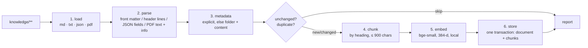

# Incident knowledge base and retrieval

Phase 5 deliverable. Code: [backend/src/ai_sre/knowledge/](../backend/src/ai_sre/knowledge/);
MCP tools: [backend/src/ai_sre/mcp_servers/knowledge.py](../backend/src/ai_sre/mcp_servers/knowledge.py);
corpus: [knowledge/](../knowledge/); evaluation set: [evals/retrieval/queries.yaml](../evals/retrieval/queries.yaml);
latest results: [eval-results/retrieval.md](eval-results/retrieval.md).

The investigator uses past incidents, runbooks, procedures, service and architecture documentation
and troubleshooting guides. Everything runs locally: PostgreSQL + pgvector for storage, a local
embedding model for vectors. **No external API calls and no LLM tokens** are spent on ingestion or
retrieval.

## 1. Use it

```bash
docker compose up -d postgres && uv run poe migrate        # tables (migration 0002)
uv run poe kb-ingest                                         # knowledge/ → PostgreSQL (idempotent)
uv run python -m ai_sre.knowledge search "pool exhausted after deploy" --type runbook --service orders-service
uv run python -m ai_sre.knowledge delete <document-id>      # or remove the file and: kb-ingest --prune
uv run poe kb-eval                                           # metrics → docs/eval-results/retrieval.md
```

The first run downloads `BAAI/bge-small-en-v1.5` (≈ 67 MB) into `.cache/fastembed`. The backend
Docker image has the model baked in, so containers work offline.

## 2. Pipeline



| Step | Implementation |
|------|----------------|
| Load | `discover()` walks `knowledge/` for `.md`, `.txt`, `.json`, `.pdf` |
| Parse | Markdown: YAML front matter + body. Text: optional title line and `key: value` header lines. JSON: incident records (`incident_id`, `root_cause`, `resolution`… become sections). PDF: `pypdf` text layer per page, title and `services:` from the document info |
| Metadata | `id`, `source` (relative path), `doc_type`, `title`, `services`, `environment`, `incident_id`, `severity`, `category`, `tags`, `timestamp` (`date`), `supersedes`; anything else is kept in `metadata` (JSONB). Missing type comes from the folder (`incidents/` → incident, `runbooks/` → runbook, `services/` → service_architecture, `architecture/`, `procedures/`, `troubleshooting/`, `operations/` → operational) |
| Validation | Unknown type, empty body, malformed YAML/JSON, PDFs without text, or an id already used by another file → reported as errors and not stored |
| Chunk | Split at headings so a chunk never mixes sections; each chunk keeps its **section path** ("Runbook: X > Remediation"), which is what citations point to. Long sections split at paragraphs (≤ 900 chars, one-paragraph overlap) |
| Embed | `title + section path + text`, so short chunks keep their context. Queries use bge's retrieval instruction |
| Store | `knowledge_documents` (metadata, `content_hash`, `embedding_model`) and `knowledge_chunks` (`vector(384)` with an HNSW cosine index; generated `tsvector` with a GIN index). Replace-in-one-transaction |
| Updates | Same source + same content hash + same model → skipped (**0 writes on re-run**). Changed content or metadata → chunks replaced. A new embedding model → everything re-embedded |
| Duplicates | Same content under a different path → reported as a duplicate, not stored |
| Deletion | `--prune` removes documents whose file is gone; `delete <id>` removes one; chunks cascade |

## 3. Retrieval

| Capability | How |
|------------|-----|
| Semantic | pgvector cosine distance over chunk embeddings (HNSW) |
| Keyword | PostgreSQL full text (`english` config), OR over the query's lexemes, `ts_rank_cd` |
| Hybrid | Reciprocal-rank fusion (k = 60) of both lists; best chunk per document |
| Filters | `doc_types`, `services` (any), `environment`, `severity`, `incident_id`, `tags` (any), `since`, `include_superseded` |
| Rerank | Metadata-aware: superseded documents × 0.5, documents about the services in question × 1.15, recency as tie-break |
| Top-k | configurable (tools: 1–10) |
| Similar incidents | Hybrid search restricted to incident / RCA documents; affected services **boost** rather than filter (a similar failure in a neighbouring service is still useful) |
| "Nothing relevant" | `confident = false` unless top similarity ≥ 0.75, or ≥ 0.62 **and** ≥ 60% of the query's terms occur somewhere in the corpus |

### Design decisions

1. **pgvector in the platform database, not a vector store.** One backup story, transactional
   updates (document and chunks replaced atomically), SQL filters next to the vector search. The
   corpus is thousands of chunks at most.
2. **Local embeddings (bge-small-en-v1.5, 384-d).** Free, offline, deterministic, fast on CPU,
   strong on the BEIR retrieval benchmarks for its size. No data leaves the machine, and no Gemini
   quota is spent.
3. **Heading-aware chunks.** Runbooks and postmortems are organised by section ("Symptoms",
   "Remediation"). Section-sized chunks make the citation meaningful ("rb-db-pool-exhaustion >
   Remediation") and keep remediation text separate from symptoms.
4. **Hybrid + RRF.** Semantic search handles paraphrase ("no free connections" ≈ "pool
   exhausted"); keyword search nails identifiers (`idle in transaction`, `order_id::text`). RRF
   needs no score calibration. Keyword alone had the lowest recall and MRR in the evaluation.
5. **Metadata rerank instead of a cross-encoder.** The evaluation showed the remaining errors were
   *conflicts* (an outdated runbook outranking its replacement) and service context, not semantic
   misunderstanding. A one-line metadata rerank fixed conflicts from 0.00 to 1.00 and raised MRR
   from 0.946 to 0.982. A cross-encoder (~100 MB, +latency) is not justified at this corpus size.
6. **Conflicts are explicit.** `supersedes: <id>` in the newer document marks the older one; it
   stays searchable (history) but is demoted, flagged `superseded_by`, and never used as a
   remediation procedure.
7. **Abstention on two signals.** bge similarities sit high even for unrelated text (the
   evaluation found no single similarity threshold that separates "no relevant document" from weak
   matches). Out-of-domain questions mention things the corpus never talks about (Kafka,
   certificates, Elasticsearch), so vocabulary coverage is the second signal.

## 4. Agent integration

MCP server `knowledge` (`/mcp/knowledge/`, read token):

| Tool | Use |
|------|-----|
| `search_knowledge(query, doc_types?, services?, top_k, mode)` | Runbooks, procedures, service/architecture docs, guides |
| `find_similar_incidents(description, services?, top_k)` | Similar past incidents (`confident` flag) |
| `get_knowledge_document(document_id, section?)` | Full sections of one document |
| `compare_with_incident(incident_id, observations, services?)` | Which current observations a past incident also describes; shared services |

Every hit carries a **citation**: `document_id`, `source` (file), `section` (path), `incident_id`.

In the investigation graph:

- **Triage** calls `find_similar_incidents` with the question and the affected services. A
  *confident* match with the same category and component adds the "historical match" term of the
  confidence rubric; unconfident matches are ignored and never cited.
- **Root cause** calls `search_knowledge` for runbooks/procedures about the cause and the
  component, and `compare_with_incident` against the historical match with the supporting
  evidence.
- **Remediation proposals** reference the non-superseded procedures they follow.
- **The report** has a *References* section: kind, source file, section, incident id, and the
  evidence id of the tool call that retrieved it. References are built only from knowledge tool
  results in the evidence, never from model output. Superseded documents are listed as "not used".

## 5. Evaluation

Dataset: 32 labelled queries ([queries.yaml](../evals/retrieval/queries.yaml)) with graded
relevance (2 = the answer, 1 = useful context):

| Kind | Queries | What it tests |
|------|--------:|---------------|
| similar_incident | 10 | a similar past incident exists (one per failure class) |
| runbook / procedure / architecture | 13 | the right operational document |
| service_filter | 3 | the same question means different documents per service |
| conflict | 2 | the 2026 runbook must outrank the superseded 2024 one |
| no_match | 4 | nothing relevant exists: must not be `confident` |

Results (hybrid + rerank, K = 5): **Recall@5 1.000, MRR 0.982, nDCG@5 0.973, conflicts 1.00,
no-match abstention 1.00, answerable queries flagged confident 27/28**. Precision@5 is 0.386
because most queries have 1–3 relevant documents for 5 slots. Full table per mode and per query:
[eval-results/retrieval.md](eval-results/retrieval.md). The integration tests enforce gates
(Recall, MRR, nDCG ≥ 0.9, conflicts = 1.0, abstention ≥ 0.75, hybrid + rerank ≥ either mode alone).

Caveat: 32 queries over 26 synthetic documents is a small set written by the same author as the
corpus. The numbers show the mechanisms work; they are not a claim about a real company's wiki.

## 6. Tests

| Command | What |
|---------|------|
| `uv run poe test-py` | loaders for every format and their metadata, validation errors, content hashing, heading-aware chunking, hashing embedder, RRF, ranking metrics; agent graph: references only from retrieved results, superseded runbooks never used, unconfident incidents never cited |
| `uv run poe test-integration` | in a throwaway schema: idempotent ingestion (0 writes), updates replace chunks, duplicates skipped, prune + delete (chunks cascade), invalid documents reported, every metadata filter, evaluation gates with the real model, similar-incident search with abstention, all four MCP knowledge tools over the MCP protocol |
| `uv run poe test-agent-e2e` | scenario A end to end: the final report's references exist in `knowledge/` and include a runbook or procedure |
