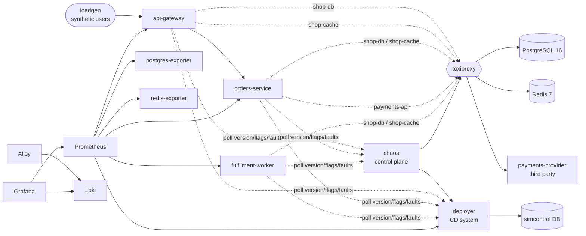

# Simulated production environment

> **Everything described here is SIMULATED.** It is a small synthetic shop that runs on your
> machine so AI SRE has realistic incidents to investigate. No real users, payments or
> production systems are involved. Every log line carries `"simulated": true`, every metric
> series `environment="simulated-prod"`, every HTTP response `X-Simulated-Environment: true`,
> and the Grafana folder is called "SIMULATED environment".

Phase 2 deliverable. Code: [simulator/](../simulator/) (package `ai_sre_simulator`). Compose file:
[docker-compose.sim.yml](../docker-compose.sim.yml). Scenario docs: [docs/scenarios/](scenarios/).

## 1. Quick start

```bash
uv run poe sim-up                       # build + start (~2 min first time); waits until healthy
uv run simctl scenarios                 # list the predefined incidents
uv run simctl trigger redis-outage      # start one
#   … investigate in Grafana http://127.0.0.1:3000 or via the Prometheus / Loki APIs …
uv run simctl clear                     # end it (reversible)
uv run poe sim-reset                    # back to the deterministic baseline
uv run poe sim-down                     # stop (volumes kept); sim-reset-hard rebuilds from scratch
```

It runs as its own compose project (`ai-sre-sim`) next to the AI SRE platform
(`docker-compose.yml`): separate database, cache and ports. Both can run at the same time.

| URL (127.0.0.1 only) | What |
|----------------------|------|
| <http://127.0.0.1:3000> | Grafana: "[SIMULATED] Shop overview" dashboard (anonymous viewer; admin password `SIM_GRAFANA_ADMIN_PASSWORD`, default `simulated-only`) |
| <http://127.0.0.1:9090> | Prometheus: PromQL API, alert rules (`/api/v1/alerts`) |
| <http://127.0.0.1:3100> | Loki: LogQL API |
| <http://127.0.0.1:8202/docs> | deployer: deployment history API |
| <http://127.0.0.1:8200/docs> | api-gateway: the shop's public API |
| <http://127.0.0.1:8210/docs> | chaos: fault injection control plane (what `simctl` talks to) |

## 2. Topology



| Component | Role | Observable? |
|-----------|------|-------------|
| `api-gateway` (3.8.0) | Public API: catalog (PostgreSQL + Redis cache-aside), carts (Redis), proxies orders | metrics + logs |
| `orders-service` (2.3.1) | Places orders (DB transaction → payments → fulfilment queue), order lookups, order history. Pool of 8 connections | metrics + logs |
| `fulfilment-worker` (1.6.2) | Consumes `queue:fulfilment` (Redis list), 2 consumers, retries ×5 then dead-letters | metrics (:9100) + logs |
| `postgres` | Shop data (2,000 customers, 500 products, 120k orders, 600k items) with `pg_stat_statements` and a 250 ms slow-query log | exporter + logs |
| `redis` | Catalog cache, carts, fulfilment queue | exporter + logs |
| `deployer` | Simulated CD system: deployment history and rollouts | metrics + logs + API |
| `payments-provider` | A **third-party** payment provider: you would not have its telemetry | hidden |
| `toxiproxy` | Network fault injection between the services and PostgreSQL / Redis / payments | hidden |
| `chaos` | Fault and scenario control plane | hidden |
| `loadgen` | Seeded, open-loop synthetic traffic, 10 req/s by default | hidden |
| `prometheus`, `loki`, `alloy`, `grafana`, `postgres-exporter`, `redis-exporter` | Monitoring | n/a |

**Hidden on purpose.** The future investigator must work like an SRE: from symptoms. The fault
controller, Toxiproxy, the load generator and the third-party provider are not scraped and
their logs are not shipped. Fault definitions never appear in any metric, log or public API.
Behaviour flags of a build live inside the deployer and are not part of its public deployment
records.

## 3. Monitoring interfaces (what an SRE uses)

### 3.1 Metrics (Prometheus)

Scrape interval 5 s. Prometheus adds `service` and `environment="simulated-prod"` to every series.

| Metric | Labels | Meaning |
|--------|--------|---------|
| `http_server_requests_total` | `method`, `route`, `status` | Requests by endpoint template and status code (request counts, error rate) |
| `http_server_request_duration_seconds` (histogram) | `method`, `route` | Endpoint latency |
| `http_server_requests_in_flight` | | Concurrent requests |
| `http_client_requests_total` / `http_client_request_duration_seconds` | `peer`, `method`, `status` (`error` = connection failure/timeout) | Calls to orders-service / payments-provider |
| `db_query_duration_seconds` (histogram) | `query` (stable name) | Client-side query latency |
| `db_query_errors_total` | `query`, `error` | Failed queries |
| `db_pool_max_connections`, `db_pool_connections_in_use`, `db_pool_connections_idle`, `db_pool_pending_acquires` | | Connection-pool utilisation |
| `db_pool_acquire_duration_seconds` (histogram), `db_pool_acquire_timeouts_total` | | Waiting for connections |
| `redis_command_duration_seconds` (histogram), `redis_command_errors_total` | `command`, `error` | Redis latency and failures |
| `cache_requests_total` | `cache`, `result` (`hit`/`miss`/`error`) | Catalog cache |
| `queue_depth` | `queue` (`fulfilment`, `fulfilment-dead-letter`) | Queue depth |
| `queue_oldest_job_age_seconds`, `queue_jobs_enqueued_total` | `queue` | Queue age and inflow |
| `worker_jobs_processed_total` | `queue`, `result` (`success`/`retried`/`dead_lettered`) | Worker throughput |
| `worker_job_failures_total` | `queue`, `reason` (exception type) | Worker failures |
| `worker_job_duration_seconds`, `worker_busy_consumers` | | Worker latency and saturation |
| `orders_created_total` | `result` (`success`/`payment_failed`/`enqueue_failed`) | Business outcome |
| `app_build_info` | `version` | Running version (value 1) |
| `process_cpu_seconds_total`, `process_resident_memory_bytes`, `process_start_time_seconds`, … | | CPU, memory, restarts |
| `deployments_total`, `deployments_in_progress`, `deployment_last_completed_timestamp_seconds` | `target_service`, `kind`, `status` | From the deployer |
| `pg_stat_activity_count`, `pg_stat_database_*`, `pg_stat_statements_*`, `pg_long_running_transactions*` | | postgres-exporter (`service="postgres"`) |
| `redis_up`, `redis_connected_clients`, … | | redis-exporter (`service="redis"`); it connects through the same network path as the services |

Alert rules ([deploy/sim/prometheus/alerts.yml](../deploy/sim/prometheus/alerts.yml)):
`HighErrorRate`, `HighLatencyP99`, `ServiceDown`, `HighMemoryUsage`, `DBPoolSaturated`,
`DBPoolAcquireTimeouts`, `RedisDown`, `RedisCommandErrors`, `UpstreamErrors`,
`FulfilmentQueueBacklog`, `FulfilmentJobFailures`.

### 3.2 Logs (Loki)

Alloy ships the stdout of observable containers to Loki with labels `service`, `container`,
`environment` and `level` (from the JSON `severity`). Shop services log one JSON object per line:

```json
{"timestamp": "2026-11-23T10:39:41.118Z", "severity": "ERROR", "service": "orders-service",
 "environment": "simulated-prod", "simulated": true, "version": "2.4.0",
 "trace_id": "84baebae4721f81665ba448d75f3b0bf", "span_id": "26f7a97b8f3d58a1",
 "request_id": "c72c468e23ee7e4c", "endpoint": "GET /customers/{customer_id}/orders",
 "logger": "http",
 "message": "timed out after 2.0s waiting for a database connection (pool size=8, in use=8, waiting=12)",
 "error": {"type": "PoolTimeoutError", "message": "timed out after 2.0s waiting for …"}}
```

| Field | Notes |
|-------|-------|
| `timestamp` | RFC 3339, UTC, milliseconds |
| `severity` | `DEBUG`/`INFO`/`WARNING`/`ERROR`/`CRITICAL` |
| `service`, `environment`, `simulated`, `version` | `version` is the build that served the request (a canary may differ from the stable version) |
| `trace_id`, `span_id` | W3C trace context. Propagated gateway → orders-service → fulfilment job (`traceparent` header, job payload) |
| `request_id` | `X-Request-ID`, propagated the same way |
| `endpoint` | `METHOD /route/{template}`, or `job queue:fulfilment` in the worker |
| `message` | Human-readable; error signatures are stable templates with variable parts |
| `error` | `{type, message, stack?}` on failures (`stack` only for unhandled exceptions) |
| extra | e.g. `status_code`, `duration_ms`, `order_id`, `attempt`, `peer`, `deployment_id` |

Every request produces an access-log line (`logger=http.access`, INFO/WARNING/ERROR by status).
PostgreSQL logs statements slower than 250 ms (text format, `service="postgres"`).

Example queries:

```logql
{service="orders-service", level="ERROR"}
{service="api-gateway"} | json | version="3.9.0"
{environment="simulated-prod"} |= "84baebae4721f81665ba448d75f3b0bf"      # one trace, all services
sum by (service) (count_over_time({level="ERROR"}[5m]))
```

### 3.3 Deployment records (deployer API)

`GET /api/v1/deployments?service=&since=&until=&status=&limit=` (newest first),
`GET /api/v1/deployments/{id}`, `GET /api/v1/services` (current versions).

```json
{"id": "d-408", "service": "orders-service", "kind": "deploy", "version": "2.4.0",
 "previous_version": "2.3.1", "status": "succeeded",
 "started_at": "2026-11-23T10:39:27Z", "finished_at": "2026-11-23T10:39:28Z",
 "changes_summary": "Order history: include line items for each order (mobile app v5)",
 "author": "m.okafor", "commit_sha": "61b9cff98fd3", "failure_reason": null}
```

`kind` is `deploy`, `rollback` or `config_change`; `status` is `in_progress`, `succeeded` or
`failed`. Every environment starts with the same six historical deployments (`d-401`…`d-406`,
over the past six days). Scenario deployments continue from `d-407`. Rollouts are also logged by
the `deployer` service ("deployment d-408 started / succeeded / failed").

## 4. Fault injection

Faults are injected through the chaos API or `simctl` and are always **reversible**.

| Fault type | Targets | Mechanism | Effect | Key params (defaults) |
|------------|---------|-----------|--------|-----------------------|
| `api_latency` | api-gateway, orders-service | in-app | Delay before handling matching requests | `delay_ms`, `jitter_ms=0`, `probability=1`, `route_prefix=/` |
| `http_errors` | api-gateway, orders-service | in-app | Fraction of requests fail with an unhandled 500 | `rate`, `route_prefix=/` |
| `db_pool_exhaustion` | api-gateway, orders-service, fulfilment-worker | in-app | Requests leak connections (left *idle in transaction*) until the pool is empty | `leak_probability=0.25`, `max_leaked=pool size` |
| `slow_db_queries` | api-gateway, orders-service, fulfilment-worker | in-app | Query-plan regression: index scans disabled for the named queries → real sequential scans | `queries=["*"]` |
| `db_network_latency` | shop-db | network | Latency on the path to PostgreSQL | `latency_ms`, `jitter_ms=0` |
| `redis_failure` | shop-cache | network | `down` (refused), `timeout` (black hole), `latency` | `mode=timeout`, `latency_ms=800` |
| `worker_backlog` | fulfilment-worker | in-app | Jobs slow down and fail → retries → backlog | `delay_ms=1500`, `failure_rate=0.5` |
| `failed_deployment` | api-gateway, orders-service | deployment | Rollout whose canary fails every request; deploy ends `failed` | `version`, `canary_fraction=0.25` |
| `memory_pressure` | api-gateway, orders-service, fulfilment-worker | in-app | Resident memory grows at a fixed rate | `mb_per_second=2`, `max_mb=200` |
| `dependency_outage` | payments-provider | network | Third party unreachable (`down`) or hanging (`timeout`) | `mode=down` |
| `dependency_errors` | payments-provider | in-app (provider) | Provider returns errors / is slow | `error_rate=0.5`, `status=503`, `extra_latency_ms=0` |
| `traffic_surge` | loadgen | traffic | Multiplies user traffic | `multiplier` |

Mechanisms:

- **in-app**: services poll `chaos` every second for their active faults and apply them in code
  paths that behave like real failures. For example, a leaked connection really is idle in a
  transaction in `pg_stat_activity`, and slow queries really are sequential scans.
- **network**: `chaos` adds a Toxiproxy toxic or disables a proxy. The services see genuine
  timeouts and refused connections.
- **deployment**: `chaos` asks the deployer for a rollout. The new build's *behaviour flags*
  (hidden) change what the service does. This is how "a deploy introduced a bug" is modelled:
  the bug ships *in the version*, and a rollback removes it.

```bash
uv run simctl fault-types                                            # catalog with parameters
uv run simctl inject api_latency --target api-gateway --param delay_ms=400 --param jitter_ms=100
uv run simctl inject slow_db_queries --target orders-service --param 'queries=["get_order"]'
uv run simctl status                                                 # active runs and faults
uv run simctl remove f-0001                                          # one fault
uv run simctl clear                                                  # everything
```

API equivalents: `POST /api/v1/faults` `{type, target, params, seed?}`,
`DELETE /api/v1/faults/{id}`, `POST /api/v1/clear` on <http://127.0.0.1:8210>. Invalid requests
get a 422 that names the valid targets or parameter bounds.

## 5. Scenarios

A scenario is a deterministic timeline of deployments and faults
([simulator/scenarios/*.yaml](../simulator/scenarios/)). `simctl trigger <id> [--speed N]` starts
one (`--speed` compresses delays between steps), and `simctl clear` reverses it. Deployments are
reverted with recorded `rollback` deployments, as in real life. Only one scenario run can be
active at a time.

| | Scenario | Category | One-line story |
|-|----------|----------|----------------|
| A | [orders-n-plus-one-deploy](scenarios/orders-n-plus-one-deploy.md) | bad_deploy | orders 2.4.0 adds an N+1 unindexed query → DB pool saturation; red-herring gateway deploy 4 min earlier |
| B | [redis-outage](scenarios/redis-outage.md) | cache_failure | Redis black-holed → slower catalog, cart 503s, paid orders not queued |
| C | [worker-deploy-backlog](scenarios/worker-deploy-backlog.md) | bad_deploy | worker 1.7.0 label-client timeouts → fulfilment queue accumulates, API healthy |
| D | [payments-provider-errors](scenarios/payments-provider-errors.md) | dependency_failure | Third-party PSP returns 503s → order placement 502s, nothing changed internally |
| E | [db-connection-leak](scenarios/db-connection-leak.md) | config_change | Feature flag leaks connections → pool exhausted, queries still fast |
| F | [gateway-failed-canary](scenarios/gateway-failed-canary.md) | failed_deploy | 3.9.0 canary rejects its config → 25% of gateway requests fail; deploy `failed` |
| G | [gateway-memory-leak](scenarios/gateway-memory-leak.md) | bad_deploy | 3.8.2 unbounded cache → linear RSS growth → OOM kill and restart loop |
| H | [db-network-latency](scenarios/db-network-latency.md) | infrastructure | +120 ms on the DB network path → uniform query slowdown, healthy DB |

Each scenario page describes the timeline, expected signals with example queries, the root cause
(ground truth for evaluation) and how clearing behaves.

## 6. Determinism

What is deterministic:

- **Data:** the seed data is generated arithmetically (no `random()`): identical rows everywhere.
- **History:** the baseline deployments `d-401…d-406` and their relative times.
- **Scenarios:** fixed steps, parameters and seed. After `simctl reset`, a scenario produces the
  same run id, deployment ids (`d-407`, …), fault ids (`f-0001`, …) and records (tested).
- **Per-request decisions:** which request fails, leaks or gets jitter comes from a counter-based
  sampler `blake2b(seed:key:n)`, not from the clock. `reset` starts a new *epoch*, which
  restarts every service's sampler and the load generator's request sequence.
- **Traffic:** the load generator's sequence of endpoints and ids is `random.Random(seed)`.

What is not deterministic: magnitudes that depend on the host (absolute latencies,
sequential-scan time, how fast a pool saturates) and the exact interleaving of concurrent
requests. Tests therefore assert *direction and thresholds* ("p95 > 50 ms", "pool at max"), not
exact values. For byte-identical inputs to the AI investigator, record tool responses once and
replay them (the evaluation harness's cassette mechanism, Phase 4).

## 7. Reset

| Command | Effect |
|---------|--------|
| `uv run simctl clear` / `POST /api/v1/clear` | Clears active scenario runs and faults; records rollbacks; history is kept |
| `uv run poe sim-reset` / `simctl reset` | Clear + restore the baseline deployment history + empty queues and catalog cache + terminate leaked DB sessions + `pg_stat_statements_reset()` + new epoch |
| `simctl reset --data` | …and delete orders created since the seed |
| `uv run poe sim-reset-hard` | `docker compose down -v` + rebuild + start (seed takes ~6 s) |

## 8. Tests

| Command | What | Time |
|---------|------|------|
| `uv run poe test-py` | Unit tests: scenario schema + docs coverage, fault validation, sampler determinism, log schema, middleware (route templates, trace propagation, error/canary hooks), load generator, CLI | ~15 s |
| `uv run poe test-sim` | Live tests against the running environment: telemetry contract, every scenario A–H (signals in Prometheus/Loki/deployer, then recovery after `clear`), every fault primitive (observable and reversible), determinism of records after reset, reset to baseline | ~20 min |

## 9. Configuration

Compose reads optional overrides from `.env` (see [.env.example](../.env.example)):
`SIM_LOADGEN_RPS` (10), `SIM_POSTGRES_PASSWORD`, `SIM_GRAFANA_ADMIN_PASSWORD`, and host ports
`SIM_GATEWAY_PORT` (8200), `SIM_ORDERS_PORT` (8201), `SIM_DEPLOYER_PORT` (8202), `SIM_CHAOS_PORT`
(8210), `SIM_PROMETHEUS_PORT` (9090), `SIM_LOKI_PORT` (3100), `SIM_GRAFANA_PORT` (3000).

Inside the containers every component reads `SIM_*` variables
([common/settings.py](../simulator/src/ai_sre_simulator/common/settings.py)).

## 10. Known limitations

- Single replica per service. "Canary replicas" and OOM restarts are modelled within one
  container (a canary is a share of requests served by the canary build's code path).
- No distributed tracing backend yet: trace and request ids exist in logs and headers only
  (spans arrive with OpenTelemetry in Phase 10).
- Container-level resource metrics come from each process (`process_*`), not cAdvisor. Node-level
  metrics (disk, host CPU) are not simulated.
- Alloy reads container logs through the Docker socket (read-only mount). That is fine for local
  development, not a production pattern.
- The CI pipeline validates the compose file and runs the unit tests. The live suite needs
  Docker and ~20 minutes, so it runs locally (`poe test-sim`).
